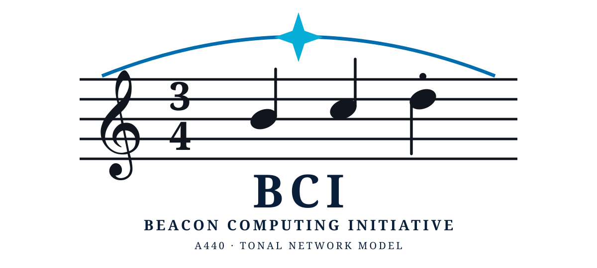
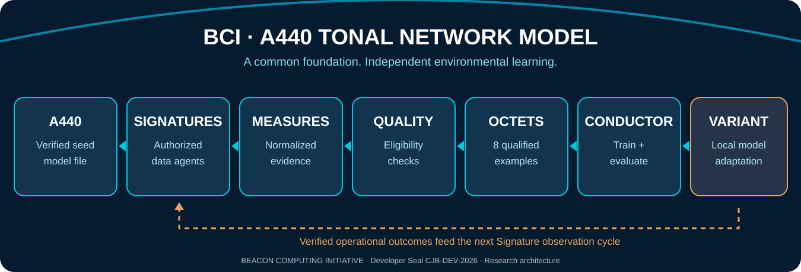

# BCIPitch
## Beacon Computing Initiative: Predictive Intelligence Through Contextual Harmony
### A440 Tonal Network Model (TNM)





**Publication package:** [Release v3.2 metadata](releases/v3.2/BCI_A440_Tonal_Network_Model_Official_v3.2.release.json) · [SHA-256](releases/v3.2/BCI_A440_Tonal_Network_Model_Official_v3.2.SHA256SUMS) · [SHA-512](releases/v3.2/BCI_A440_Tonal_Network_Model_Official_v3.2.SHA512SUMS)

> **Publication status:** The manifests record the official document hashes. The actual PDF, DOCX, and Markdown publication files are not yet committed in the repository, so these manifests cannot be fully checked against GitHub-hosted documents.

**Official research and commercial architecture | Specification v3.2 | Developer Seal: CJB-DEV-2026**

> **A shared foundational model. Independent environmental intelligence. Evidence-driven adaptation.**

**Architect and founder:** Chance Joaquin Boone  
**Organization:** Beacon Computing Initiative  
**Status:** Research architecture and proposed commercial deployment specification; not a claim of completed production capabilities.

---

## Project identity: BCIPitch

**BCIPitch** stands for **Beacon Computing Initiative: Predictive Intelligence Through Contextual Harmony**.

- **Predictive Intelligence** describes evidence-grounded forecasting, task-specific inference, and operational decision support.
- **Contextual** reflects the fact that each deployed A440 model develops from its authorized business environment, historical metrics, and ongoing observations.
- **Harmony** describes how independently sourced evidence, Measures, Octets and Tonal Variants can be brought into verifiable relationships without losing provenance.
- **Pitch** connects the engineering design to the A440 musical tuning reference, its Melody, Conductor, and independent truth voices.

BCIPitch is the **project and commercial platform name**. **A440** remains the standardized foundation model file, and **TNM** remains the name of the adaptive model architecture. This naming change does not imply that a production model or self-training system has already been completed.

## Detailed engineering pipelines

The complete **BCIPitch Pipeline Engineering Specification v3.3** documents the data contracts, failure recovery, acceptance tests, and runtime responsibilities of every pipeline from customer commissioning to adaptive learning.

**[Read the full pipeline specification →](docs/PIPELINES.md)**

| Pipeline | Detailed coverage |
|---|---|
| A440 commissioning | Business profile, historical baseline, signed deployment and immediate analytics |
| Signatures and raw ledger | Nine collector interfaces, source authorization, event provenance and bounded ingestion |
| Measures and eligibility | Normalization, quality checks, targets and train/test leakage controls |
| Octet tournament | Eight qualified examples, 8→4→2→1 hierarchy, masks and cross-branch verification |
| Conductor | CPU-aware candidate training, held-out tests, version promotion and rollback |
| C polishing | Optional numerical packing/quantization with post-conversion evaluation |
| Business inference | Verified reporting, forecasting baselines, uncertainty and citations |
| Feedback | Outcome Signatures, measured consequences, replay and local specialization |

**Operational guarantee target:** an observation enters learning **if and only if** it passes authorization, provenance, schema, privacy, and objective-specific eligibility checks; a candidate model becomes active **if and only if** separate evaluation, policy and integrity gates pass.

## 1. The vision

The **A440 Tonal Network Model** is a proposed adaptive AI architecture in which every deployment begins with the same standardized **A440 model file** and develops an independent, environment-specific **Tonal Variant**. Instead of continuously ingesting indiscriminate internet-scale corpora, authorized agents collect domain-specific observations, qualify evidence, and create compact, high-value training examples.

A440 is the *master score*: a versioned neural checkpoint with an accompanying architecture definition. Its deployed instances are independent performances of that score, shaped by the business, organization, or computing environment in which they operate.

**The objective is not merely another chatbot.** It is a system that can answer grounded operational questions, evaluate trends, forecast measurable outcomes, and selectively improve through controlled local training.

## 2. The musical foundation

The architecture takes its terminology from ensemble performance:

| Musical concept | TNM meaning |
|---|---|
| **A440** | Standardized base model checkpoint and shared architecture |
| **Seed** | Deployment of a verified A440 foundation |
| **Signatures** | Permissioned data-collection agents that observe their environment |
| **Measures** | Source-linked, normalized, quality-assessed evidence |
| **Octets** | Brackets of eight qualified training examples |
| **Conductor** | Training scheduler, evaluator, and promotion controller |
| **Truth voices** | Independently represented evidence-bearing propositions |
| **Harmonic relationships** | Tested dependencies and agreements between propositions |
| **Catalyst** | Hypothesis-generation stage for higher-order interpretations |
| **Melody** | The active reasoning trajectory and evolving local score |
| **Tonal Variant** | The validated environment-specific adaptation |

The terms are an engineering metaphor, not a substitute for specifying neural operations and evaluation criteria.

## 3. End-to-end pipeline

### Engineering flow versus business experience

The business does not need to wait for self-training before using its historic metrics. On commissioning, the A440 instance loads an approved profile and an auditable baseline, then answers metric questions by retrieving records and performing calculations. Concurrently, its Signatures observe approved sources, its Measure Engine qualifies the evidence, and its Conductor uses suitable Octets to evaluate potential behavioral improvements.

The training loop is deliberately **not** self-certifying: a proposed causal explanation, anomaly label or forecast made by the model cannot serve as independent proof of its own correctness. Feedback and verified business outcomes need provenance and independent checks.

### System boundaries

- **Data plane:** Signature events, raw ledger, Measures, and safe retrieval.
- **Learning plane:** Eligibility, eight-entry Octet assembly, training, held-out evaluation, promotion and rollback.
- **Governance plane:** A440 version identity, permissions, tenant data boundaries, retention, and audit.
- **Application plane:** Electron dashboards, explanations, grounded answers, and forecasts.

This separation permits a small-business deployment to keep answering questions while training runs opportunistically in the background, and permits enterprises to manage policies consistently without forcing all branches to share raw business data.


```text
                     A440 foundational model file
                                |
                   Verified business deployment
                                |
                 SIGNATURES — authorized collection
                                |
                 RAW EVENT LEDGER — provenance
                                |
                 MEASURES — normalized evidence
                                |
            QUALITY GATE — privacy, validity, targets
                                |
                  OCTETS — 8 qualified examples
                                |
              CONDUCTOR — candidate neural training
                                |
            EVALUATION — held-out tests and regression
                                |
                 OPTIONAL C ARTIFACT POLISHING
                                |
                  LOCAL TONAL VARIANT
                                |
            Operational answers / forecasts / outcomes
                                |
               Outcome Signatures feed next cycle
```

**Critical separation:** New observations can update auditable memory and retrieval immediately; changes to neural weights require an eligible objective, a candidate training run, independent evaluation, and explicit promotion rules.

## 4. A440 is a model file

The A440 checkpoint stores the foundational neural weights. Its companion files define architecture, encoding, versioning, compatibility, and governance. A randomly initialized checkpoint is *not* a pretrained reasoning model. A useful general-purpose A440 requires an appropriate pretraining strategy or a compatible pretrained starting point.

A deployed variant should reference the unchanged base checkpoint and keep its own adapters, memory, and provenance separately. Model policies must be enforced by trusted runtime code rather than relying on neural instructions alone.

### Illustrative file layout

```text
foundation/A440/
  A440.safetensors
  architecture.json
  manifest.sha256
instances/<tenant>/
  profile.json
  historical_baseline.db
  signatures.json
  measures.db
  octets/
  adapters/
  memory.db
  training_history/
  manifests/
```

These paths describe the proposed layout, not files already shipped in this repository.

## 5. Business commissioning: from purchase to local intelligence

A business supplies its **industry, operating scope, KPIs, reporting conventions, approved data sources, access boundaries, and historical metrics** (for example, the previous fiscal year). BCI provisions a business-specific deployment from the standard A440 model and packages:

1. **A440 reference and versioned configuration:** base model identity, runtime compatibility, and approved policies.
2. **Historical baseline:** structured, auditable financial and operational metrics, not values hidden solely in neural weights.
3. **Measure definitions:** formulas, units, accounting periods, data quality expectations, and domain terminology.
4. **Authorized Signatures:** connectors for explicitly approved systems such as point of sale, inventory, accounting, or telemetry.
5. **Local runtime and Electron dashboard:** answers, charts, forecasts, data-source status, and training oversight.
6. **Integrity metadata:** hashes, provenance, and, where provisioned, publisher-authenticated signatures.

**Day-one capabilities:** Retrieval and calculation over supplied records; baseline comparisons; simple forecasts when sufficient historical resolution exists. These do **not** require immediate customer-specific weight training.

**Maturing capabilities:** Local observations support anomaly detection, specialized language and reasoning tasks, and better forecasting *if validated against baselines*. No system should promise accurate predictions solely because it has collected more data.

### Example commissioning metrics

Revenue by period; gross margin; average order value; inventory turnover; labor utilization; customer retention; cash flow; delivery time; support resolution time. Every metric requires a definition, unit, time window, provenance, and access classification.

## 6. Signature interfaces

Nine proposed Signature categories provide modular, permission-scoped observation:

| Interface | Typical approved sources |
|---|---|
| SIG-01 System | Host health, operating system events |
| SIG-02 Network | Authorized network telemetry |
| SIG-03 Applications | Application logs and service events |
| SIG-04 Configuration | Versioned configuration state |
| SIG-05 Integrity | Checksums, integrity attestations |
| SIG-06 Performance | Latency, throughput, resource use |
| SIG-07 Knowledge | Approved documents and knowledge bases |
| SIG-08 Outcomes | Confirmed results and measured consequences |
| SIG-09 Context | Business calendars, seasonality, domain context |

Signatures **do not** receive blanket access. They require tenant-specific permissions, data minimization, revocation, retention controls, and source provenance. Observations are not automatically ground truth.

## 7. Measures: the quality engine

A Measure is a normalized unit of evidence derived from one or more raw events. Its minimum logical schema includes:

```text
measure_id | signature_id | source_refs | time_window
observation | derived_features | verification_status
uncertainty | policy_scope | quality_result | schema_version
```

Measures can express time-series aggregates, state transitions, verified outcomes, or relationships between records. Each Measure remains traceable to source observations. Contradictions, unknowns, and missing data must be preserved rather than silently resolved.

**An observation becomes training-eligible if and only if** source authorization, provenance, schema checks, privacy restrictions, and the intended learning target all pass. A quality score alone does not establish truth.

## 8. Octet tournament ingestion

An Octet contains **eight eligible examples**, not eight bytes and not eight arbitrary raw events. The proposed tournament organizes them hierarchically:

```text
8 qualified examples
    ↓ 4 pairwise relation/merge operations
4 intermediate representations
    ↓ 2 relation/merge operations
2 harmonic representations
    ↓ 1 final merge
1 bracket-level synthesis with all source references retained
```

Seven primary merges organize an eight-entry bracket. This is less than the 28 comparisons required for exhaustive all-pairs examination, but **does not guarantee** that all cross-branch relationships are discovered. Targeted checks and evidence replay are necessary where cross-branch dependencies matter.

A 100-example training queue yields 12 full Octets and one partial four-example bracket. The implementation must support masking or smaller final brackets without silently dropping data.

Octets are a **training organization mechanism**, not by themselves a tokenizer. Byte-native encoders may be benchmarked against conventional tokenization; they are not assumed to be faster.

## 9. The Conductor and controlled self-training

The Conductor manages candidate updates to the local Tonal Variant:

- Select task-compatible, verified Octets and representative replay examples.
- Schedule CPU-budgeted training without blocking business operations.
- Maintain independent training, validation, and test partitions.
- Measure task-specific performance, calibration, inference latency, and regression.
- Promote a candidate **if and only if** its authorization, held-out quality, integrity, and A440 compatibility gates pass.
- Retain a rollback checkpoint and a complete training provenance record.

The active model remains stable while candidates train. Predictions made by the model must not become trusted labels merely because the model generated them. New knowledge and new weights are separate lifecycle events.

## 10. Implementation stack

| Layer | Proposed technology |
|---|---|
| Backend and orchestration | Python |
| Neural research and training | PyTorch / NumPy |
| Evidence ledger and local memory | SQLite WAL |
| Efficient columnar / binary representations | Arrow or memory-mapped arrays |
| Optional trained-artifact polishing | C native modules, after benchmarking |
| GUI | Electron + TypeScript |
| Integrity | SHA-256 manifests; cryptographic signatures for authenticity |
| Tests | pytest, numerical regression and end-to-end evaluation |

**Python remains the backend.** C is an optional optimization/polishing layer for trained artifacts and targeted computational bottlenecks, not a replacement backend. Electron is the customer-facing control interface.

## 11. Commercial deployment tiers

**Small business:** One local A440 instance, a small set of approved Signatures, operational baselines, and bounded CPU training.

**Midmarket:** Multiple departmental Tonal Variants with separately governed data scopes and shared schema standards.

**Enterprise:** Tenant isolation, centrally governed policy, audit trails, controlled model rollouts, local/federated learning only where authorized, and secure data exchange.

The intended product is a **commissioned, continuously evidence-informed business intelligence model**, not a promise of unrestricted autonomous decision-making.

## 12. Proposed research curriculum

Five datasets of 1,000 entries each are planned:

| Dataset | Learning target | Entries |
|---|---|---:|
| TNM-Reason | Logical reasoning, uncertainty, counterexamples | 1,000 |
| TNM-Interpret | Event interpretation and structured evidence | 1,000 |
| TNM-Harmony | Dependencies, contradictions, hypotheses | 1,000 |
| TNM-Act | Authorized action selection and verified outcomes | 1,000 |
| TNM-Adapt | Eligibility, evaluation, replay, rollback | 1,000 |

**Status:** These are curriculum targets, not claims that 5,000 validated training records or a pretrained A440 checkpoint are already included here.

## 13. Development milestones

**M1 — Foundation:** Define the checkpoint, architecture manifest, input contract, and deterministic policy enforcement.

**M2 — Acquisition:** Implement Signature permissions, collection scheduling, durable events, and revocation.

**M3 — Qualification:** Implement Measure derivation, source references, uncertainty, quality checks, and learning objectives.

**M4 — Composition:** Build eight-entry Octets, hierarchical merges, masking, and cross-branch verification.

**M5 — Learning:** Train candidate adapters, run held-out evaluations, and implement gated promotion and rollback.

**M6 — Deployment:** Connect the Electron dashboard, commission test business baselines, and measure live operational usefulness.

**M7 — Validation:** Compare identical A440 seeds deployed into distinct environments; demonstrate different but traceable local adaptations while preserving compatibility.

### Required performance evidence

Record ingestion throughput, Measure qualification rate, Octet assembly latency, CPU and peak RAM, training examples/second, forecast error, held-out task accuracy, model regression, and time to rollback. Claims of efficiency require benchmark results.

## 14. Safety, provenance, and customer trust

Customer data remains governed by customer-specific authorization and retention requirements. Maintain encryption where appropriate, tenant isolation, role-based access, source auditability, and explicit approval for sensitive integrations. Hashes detect changes; **hashes alone do not authenticate authorship**. A signed release manifest is required for verifiable publisher authenticity.

Forecasts must include uncertainty and be compared with simple statistical baselines. Recommendations must cite the evidence used. Any self-training update must be reversible.

## 15. Project status and repository scope

This repository is the public **BCIPitch project home (currently named AI-Submission on GitHub)** for the A440/TNM architecture, founding concept, commercial specification, and subsequent implementation milestones. Architectural descriptions and proposed file structures are **design documentation** unless corresponding tested code and artifacts are committed.

The musical staff logo uses a **3/4 time signature** and a three-quarter-note motif, with the final note stem directed downward and a staccato mark. It is the visual emblem for the project.

## 16. Acknowledgments

The musical foundation of this work is dedicated with gratitude to **Shawn Silva and Joseph Flores**, high school band directors at **Oñate High School in Las Cruces, New Mexico**, and **Aaron Howe**, director of the **New Mexico Gay Men's Chorus**. Their mentorship, musical instruction, and support informed the ensemble metaphor at the heart of this architecture.

## 17. Publication and artifact integrity

The release metadata and checksum manifests in `releases/v3.2/` describe the official architecture document. SHA-256 and SHA-512 verify byte integrity against a trusted manifest copy; they do not prove that a publisher signed a release. A full publisher signature would require a separate private-key-backed verification method.

**Important:** An official artifact is only repository-published once its exact bytes are committed. In particular, a hash manifest alone is not a substitute for hosting the PDF and Word source documents.

## 18. Authorship and licensing

**Chance Joaquin Boone** — Founder and Architect, Beacon Computing Initiative.  
**Developer Seal:** `CJB-DEV-2026`  
**© 2026 Beacon Computing Initiative.**

**Licensing note:** No open-source license is granted by this README alone. Until a separate LICENSE file is approved and committed, copyright is reserved. Documentation, branding/artwork, code, and model weights may require different licenses. Do not infer that customer business data or future trained models are publicly licensed.

---

### The BCI principle

> **A440 supplies the common foundation. Signatures gather experience. Measures qualify evidence. Octets compose learning. The Conductor trains. Tonal Variants mature through verified outcomes.**

*Observe accurately · Preserve faithfully · Analyze transparently · Communicate securely · Act deliberately*
