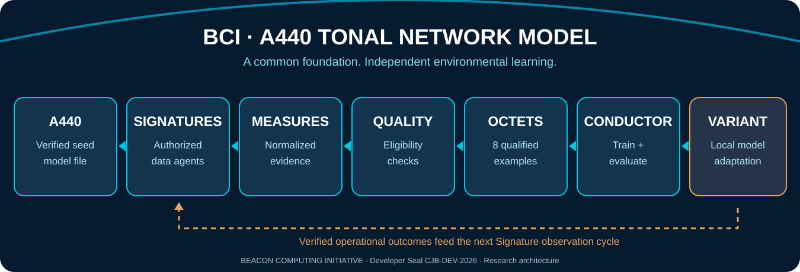

# BEACON COMPUTING INITIATIVE
# BCIPitch — Pipeline Engineering Specification

**Expanded engineering design • Specification v3.3 (proposed)**  
**Project:** BCIPitch — *Predictive Intelligence Through Contextual Harmony*  
**Foundational model:** A440 Tonal Network Model (TNM)  
**Founder and architect:** Chance Joaquin Boone  
**Developer Seal:** `CJB-DEV-2026`  
**Status:** Architecture and acceptance criteria; not proof of implemented or benchmarked components.



## 1. Design purpose and system invariants

BCIPitch's commissioning, inference and local training pipelines are deliberately separate. A client gets immediate, evidence-grounded access to historical business data; local neural specialization develops only after the system accumulates **qualified, appropriately supervised** examples.

**Main sequence:**

```text
     A440 model file + business commissioning profile
                         |
                  Signed deployment
                         |
     SIGNATURES -> RAW LEDGER -> MEASURES
                                |
                           ELIGIBILITY
                            /       \
              Memory/retrieval      TRAINING QUEUE
                                    |
                              OCTET ASSEMBLY
                                    |
                         PAIRWISE HARMONIC TREE
                                    |
                         CONDUCTOR CANDIDATE
                                    |
                           EVALUATION GATES
                              /          \
                           Reject       Promote
                                           |
                                  LOCAL TONAL VARIANT
                                           |
                             Answers / forecasts / outcomes
                                           |
                           Outcome Signatures (feedback)
```

**Non-negotiable invariants:**
- The original A440 model checkpoint is treated as immutable for ordinary local adaptation.
- Every derived Measure records its lineage to original, permitted source observations.
- No model-generated assertion becomes verified ground truth merely because it was generated.
- A bracket contains **up to eight complete eligible examples**, not eight bytes and not eight arbitrary raw events.
- Runtime access restrictions live in independently enforced application policy, not in model weights alone.
- Failed, interrupted, or uncertain training attempts do not replace the current active model.
- Cross-tenant raw data never travels over the harmonic exchange bus without explicit authorization.

## 2. Pipeline A — Commercial commissioning and A440 installation

**Inputs:** industry and organization profile; fiscal calendar; approved business metrics and their formulas; at least one historical period where provided; supported source connection configuration; tenant policy and roles.

**Processing:** validate contractual/administrative authority, inspect import schemas, normalize accounting units and time zones, record historical coverage, initialize an immutable A440 checkpoint reference and separate tenant memory, configure Signatures disabled by default until approved, and provision the Electron dashboard.

**Outputs:**
- `commissioning/profile.json` — industry, operations, units, business calendar, data classification.
- `commissioning/metric_registry.json` — each KPI's formula, owner, aggregation, timezone and denominator.
- `commissioning/baseline.db` — historical metrics retaining original source references.
- `instances/<id>/model_ref.json` — A440 revision and compatibility metadata.
- `instances/<id>/policy.json` — separately enforced authorization, collection and retention.
- Tenant-bound integrity manifest (SHA-256) and, for authenticity, an authenticated signature.

**Gate:** Deploy if and only if the package passes checksum/integrity verification, the baseline imports without unsupported schema coercions, and an authorized administrator approves the enabled sources.

**Important:** A business can ask grounded questions about its historical numbers immediately through retrieval and deterministic calculations. Business-specific neural training is not a prerequisite.

## 3. Pipeline B — Signatures: authorized environmental acquisition

The nine proposed Signature classes are *interfaces*, not nine universally active background scanners.

| ID | Source class | Example records | Permission scope |
|---|---|---|---|
| SIG-01 | System | uptime, host state, process summaries | Allowlisted hosts |
| SIG-02 | Network | approved traffic summaries, service health | Scoped interfaces/networks |
| SIG-03 | Applications | app events, transaction statuses | Named apps and tenants |
| SIG-04 | Configuration | approved config revisions | Named configs and paths |
| SIG-05 | Integrity | file digest changes, signed status | Allowlisted assets |
| SIG-06 | Performance | utilization, latency, queue depth | Selected metrics |
| SIG-07 | Knowledge | approved internal documents | ACL-protected collections |
| SIG-08 | Outcomes | confirmed actions, observed consequences | Approved action/output logs |
| SIG-09 | Context | holidays, schedules, seasonality | Approved business context |

Each Signature has a `signature_id`, owner, enabled status, polling interval or subscription trigger, sampling cap, timeout, cursor, permitted fields, scope, retention policy, and revocation condition.

**Ingest contract:**

```json
{
  "event_id": "evt-001",
  "tenant_id": "tenant-example",
  "signature_id": "SIG-06",
  "source_id": "pos-terminal-07",
  "observed_at_utc": "2026-11-01T18:00:00Z",
  "received_at_utc": "2026-11-01T18:00:01Z",
  "schema_version": "1",
  "payload_type": "metric.sample",
  "payload": {"name": "checkout_latency_ms", "value": 187.0, "unit": "ms"},
  "collection_scope": "approved-pos",
  "source_digest_sha256": "<computed-at-ingest>",
  "collection_status": "ok"
}
```

**Implementation:** bounded async queues with durable SQLite WAL append, source-specific idempotency keys, monotonic sequence cursors, retry-with-jitter, backpressure and shutdown/revocation hooks. Keep original values and record any sanitization separately.

**Failure behavior:** collector timeout -> retry with cap; revoked source -> halt collection; malformed event -> quarantine with reason; overloaded queue -> apply policy-defined throttling rather than silently losing evidence.

**Metrics:** `events_received`, `events_rejected`, `collector_lag_ms`, `duplicate_rate`, `queue_depth`, `signature_uptime`.

## 4. Pipeline C — Raw ledger and source preservation

Store append-only event identity, source lineage, event time, receipt time, schema version and content digests in a SQLite WAL ledger. Payloads may be kept encrypted or externally referenced per tenant retention policy. Use deduplication with an explicit equivalence rule rather than dropping same-looking events from different origins.

Support event replay by source cursor and by time window; record missing intervals and clock skew. Preserve redacted audit records where content deletion is required. Expired data must not remain in training caches beyond the permitted retention.

A hash ensures byte integrity against a trusted comparison value; **it is not a cryptographic publisher signature**.

## 5. Pipeline D — Measures: transform observations into defensible evidence

Measures are the crucial boundary between raw data and model cognition. They are typed, reproducible interpretations with explicit verification status.

**Processing stages:**
1. Validate schema and authorized origin.
2. Canonicalize units, timestamps, currencies, fiscal periods and entity identifiers.
3. Join or aggregate within explicitly defined windows; preserve missing values.
4. Detect transitions, baseline deviations, trends, contradictions and relevant dependencies.
5. Derive deterministic KPIs where possible; attach formula version and inputs.
6. Assign provenance and quality diagnostics, separating *source reliability* from *truth*.
7. Write normalized Measure with immutable source references.

**Measure record contract:**

```json
{
  "measure_id": "msr-2026-000018",
  "tenant_id": "tenant-example",
  "kind": "metric_change",
  "signature_ids": ["SIG-06", "SIG-03"],
  "event_refs": ["evt-001", "evt-002"],
  "time_window": {"start": "2026-11-01T17:00:00Z", "end": "2026-11-01T18:00:00Z"},
  "metric": "checkout_latency_ms",
  "observation": 187.0,
  "baseline": 150.0,
  "unit": "ms",
  "derived": {"delta_ms": 37.0},
  "verification": "source_observed",
  "uncertainty": {"missing_samples": 0},
  "quality": {"schema_pass": true, "provenance_pass": true},
  "schema_version": "1"
}
```

**Do not equate** `source_observed` with independently verified truth. A logical dependency `T1 ⇔ T2` can be recorded as established only when both implications are separately supported; otherwise use `related`, `correlated` or `hypothesis`.

**Metrics:** Measure latency, invalid-schema rate, unit normalization errors, incomplete-window rate, provenance coverage, and reproducibility.

## 6. Pipeline E — Eligibility: turning Measures into learning examples

Not every Measure warrants weight training. The eligibility stage defines a model objective and a defensible target. Allowed examples include:
- Predicting an upcoming measurable state from past authorized telemetry (self-supervised with future observations withheld during training).
- Classifying an event with a separate verified outcome label.
- Answering a business question grounded in a known, reproducible computation.
- Testing logical consistency or contradiction against explicitly labeled relations.

**Eligibility gate:**

```text
eligible(example) iff
  permitted_source
  AND verified_provenance
  AND valid_schema
  AND privacy_and_retention_compliant
  AND objective_defined
  AND target_available_or_valid_self_supervision
  AND split_leakage_checks_pass
```

Preserve rejected examples and reasons in a constrained quarantine store; do not reuse model-produced labels as facts. Prevent related time windows or customers appearing across train/test partitions in ways that inflate performance.

**Output:** typed `TrainingExample` records referencing Measure IDs, objective, target, confidence limits, weight, group and split assignment. Dataset records may originate as JSONL, but precompute compact binary representations for the training hot path.

## 7. Pipeline F — Octet tournament composition

An Octet is **eight compatible qualified examples** as a learning composition. Group by learning objective and compatible contexts; examples need not represent eight agents.

```text
Round 0: e1   e2   e3   e4   e5   e6   e7   e8
           \ /      \ /      \ /      \ /
Round 1:   p12      p34      p56      p78
             \       /         \       /
Round 2:       h1234            h5678
                  \              /
Round 3:              synthesis
```

Four pair operations + two harmonic merges + one synthesis = **seven primary merges**. The tree produces combined representations and *candidate* relationship labels; it does not eliminate observations, guarantee truth, or discover every possible cross-branch relation. Keep an optional sparse cross-branch verifier for likely missed dependencies and preserve all eight entry references.

**Training detail:** loss can include supervised per-entry objectives, separately labeled pair/harmonic relations, and a bracket-level prediction objective. Do not invent relational labels. Training can execute in smaller CPU microbatches with gradient accumulation while retaining an eight-entry logical bracket.

**Partial brackets:** process 1–7 remaining eligible entries with explicit masks. No data loss, no fabricated filler labels.

**Measures of success:** bracket construction throughput, memory, relation-classification precision/recall, target prediction error, and cross-branch miss rate.

## 8. Pipeline G — Conductor: CPU-first candidate training

The **Conductor** is the *trainer*, not the runtime thought scheduler. Python orchestrates loading, scheduling, training targets and evaluation; PyTorch/NumPy can execute the neural math through optimized native kernels. Native C polishing may follow training when benchmarked and justified.

**Control cycle:**

```text
eligible Octets + replay examples
           |
check CPU/RAM budget + model policy
           |
copy current adapter -> candidate
           |
microbatch training + checkpointing
           |
held-out evaluation + past-task regression
           |
    POLICY + QUALITY + INTEGRITY
           /                    \
     reject/rollback           promote
                                  |
                       atomic active adapter swap
```

**Training is started if and only if** quality supply, authorization and resource budgets pass.  
**Promotion occurs if and only if** required held-out metrics pass, no regression exceeds allowed bounds, the artifact is valid, and A440 policy permits the update.

For CPU-only prototypes:
- Cache encodings; avoid reparsing JSONL at every epoch.
- Isolate inference from training with an independent worker and low-priority scheduling.
- Prefer a small trainable adapter over re-training the entire base when hardware is constrained.
- Use conservative thread counts, bounded activation buffers, checkpoint intervals and resource limits.
- Record actual `examples_per_second`, `training_loss`, held-out metrics, latency, CPU load and peak RSS.

## 9. Pipeline H — C polishing and artifact verification

The production backend remains **Python**. Optional native C functions can implement tested weight packing, numeric format conversion, quantization or high-throughput batch transforms. These functions must not modify the underlying ground-truth observations.

**Inputs:** candidate weight artifact plus exact architecture/quantization metadata.  
**Outputs:** polished artifact, conversion report, measured accuracy delta and integrity hashes.

A polished artifact is deployable **only if** its compatibility, numerical and held-out performance checks pass. A lower-byte-count model with unacceptable forecast regression is rejected.

## 10. Pipeline I — Business inference, analytics and forecasting

**Query path:**

```text
User request -> tenant permission -> task classification
  -> deterministic metric engine / validated query
  -> auditable retrieved evidence
  -> optional TNM language synthesis
  -> source-linked response + freshness + uncertainty
```

Use deterministic arithmetic for exact KPI reporting and appropriate statistical/time-series models as forecasting baselines. Forecast outputs should include horizon, training cutoff, backtest metrics, known assumptions and uncertainty intervals. Evaluate specialized TNM forecasting against simple baselines such as seasonal naïve models before claiming improvements.

Actions affecting customer operations require separate scoped tools and explicit business authorization; a generated recommendation is not permission.

## 11. Pipeline J — Continuous feedback and local specialization

Outcome Signatures observe independently verifiable consequences of previous actions and predictions. A feedback record must distinguish:
- what the model predicted;
- what action was actually authorized and executed;
- what external outcome was later observed;
- what confounding or missing information remains.

Positive feedback does not automatically mean a model was causally correct; use controlled comparisons or appropriate evaluation designs where possible. New validated examples enter the next Measure/Octet cycle, while prior representative tasks are replayed to reduce forgetting.

Two deployments may begin from the same A440 file and develop different **local Tonal Variant** adapters. Their sensitive business memory remains locally governed, and policy enforces boundaries on any exchange.

## 12. Concurrency, failure recovery and observability

| Worker | Operational priority | Recommended behavior |
|---|---|---|
| Signature polling | High | Bounded concurrency and scoped rates |
| Ledger writes | High | Durable transaction and cursor advancement |
| Measure derivation | Medium | Async, incremental, replayable |
| Inference/retrieval | High when requested | Bounded, tenant-aware |
| Octet composition | Low/medium | Queue-driven, cached |
| Conductor training | Lowest | Preemptible, checkpointed |
| C polishing | Lowest | Offline candidate transformation |
| Electron UI | Interactive | Read service state, never block on training |

**Crash recovery:** restart from durable source cursors and idempotency keys; avoid duplicate Measures; resume only checkpoints verified by hash and compatible model/optimizer state; never partially activate a candidate adapter.

**Health and telemetry:** ingestion lag, Signature failures, ledger size, Measure rejection reasons, eligible-example backlog, active/candidate version, Octet throughput, train/eval loss, CPU/RSS, forecast drift, and rollback count. Publish these to the Electron dashboard with clear timestamps and access controls.

## 13. Release acceptance test matrix

| Test | Pass criterion |
|---|---|
| A440 integrity | Checkpoint and architecture hashes match trusted manifest |
| Signature scope | No collection outside approved allowlists |
| Ingestion replay | No silent losses or duplicate training identities |
| Measure correctness | Deterministic outputs reproduce from source events |
| Eligibility | Every training example has valid authorization and target |
| Eight-entry brackets | No eligible entries lost; partial brackets supported |
| Harmonic semantics | No unsupported biconditionals promoted as verified |
| Conductor isolation | Live inference works during training |
| Promotion/rollback | Bad candidate rejected; previous active weights preserved |
| Forecast evaluation | Backtest compared with established statistical baseline |
| Tenant boundaries | No unauthorized cross-tenant data exchange |
| Audit | Every promoted adapter references its training data lineage and evaluation report |

## 14. Proposed repository modules

```text
src/bcipitch/
  a440/            # checkpoint loading, version/manifest checks
  signatures/      # permissioned source collectors
  ledger/          # durable raw event storage
  measures/        # temporal/metric derivation, provenance
  eligibility/     # example objectives, labels and split controls
  octets/          # bracket builder, tournament and masks
  conductor/       # CPU training, eval and promotion
  tonal/           # Melody, truth voices, harmonic inference
  business/        # commissioning, metric registry, forecasting
  polish/          # optional native C bindings
  api/             # service endpoints for Electron
gui/electron/
assets/branding/
assets/illustrations/
docs/PIPELINES.md
```

Module layout is **proposed**; unimplemented files should not be represented as functional.

## 15. BCI documentation control

**Developer Seal:** CJB-DEV-2026.  
**Project:** BCIPitch / A440 TNM.  
**Document:** Pipeline Engineering Specification v3.3.  
**Integrity:** compute and store SHA-256 digest from final artifact bytes; do not invent a checksum.  
**Founding acknowledgment:** Musical inspiration credits Shawn Silva and Joseph Flores of Oñate High School, Las Cruces, New Mexico, and Aaron Howe of the New Mexico Gay Men's Chorus.

*Observe accurately · Preserve faithfully · Analyze transparently · Communicate securely · Act deliberately*
