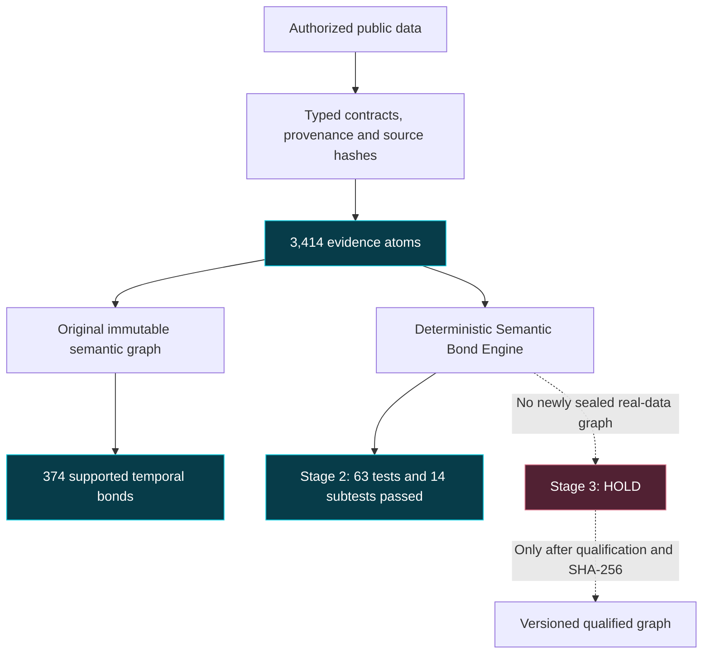
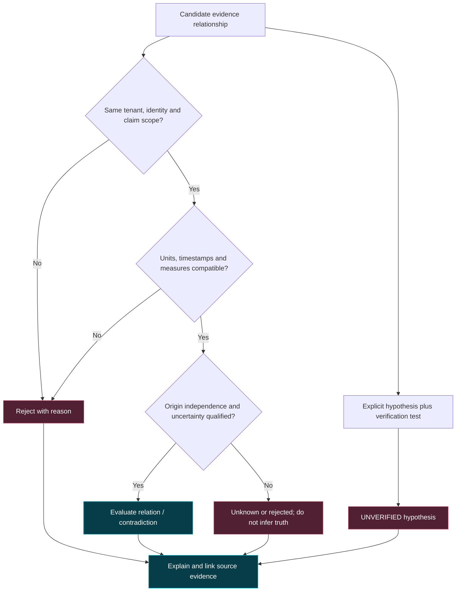
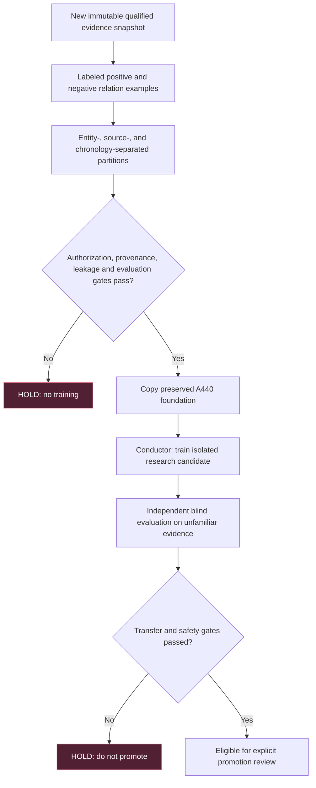
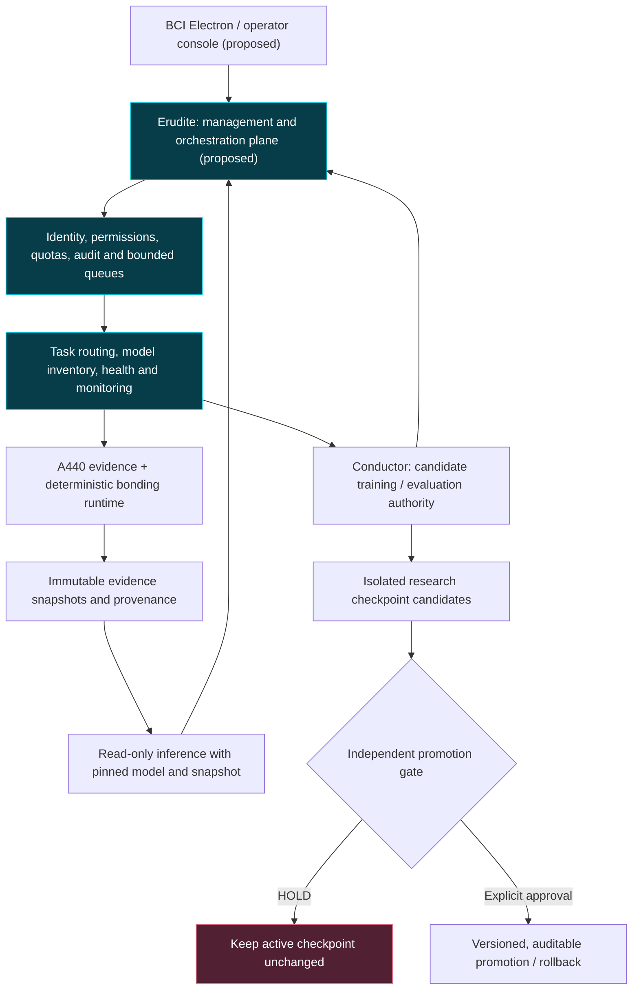

# BEACON COMPUTING INITIATIVE
# BCIPitch / A440 - Capability Learning and Management Architecture

**Developer Seal:** `CJB-DEV-2026`  
**Status:** M2.16.3 Stage 2 tests PASS; Stage 3 real-data integration HOLD  
**Date:** 2026-11-06  
**Neural training:** NOT AUTHORIZED  
**Neural mapping:** NOT QUALIFIED

This is a research architecture and a status-aware visual record, not evidence of an implemented multi-model management stack. The BCI Erudite management role is **proposed**; it does not merge model weights, replace A440's Conductor or authorize training.

## 1. Evidence pipeline and tested foundation

| Source (2025) | Accepted atoms | Qualification |
| --- | ---: | --- |
| USGS earthquakes M5+ | 2,130 | Irregular, logarithmic magnitude events |
| NYC TLC monthly reports | 908 | Mixed monthly metrics, review-only for neural feature compilation |
| USGS streamflow | 365 | Daily mean, nonadditive physical rate |
| BLS unemployment | 11 | Monthly percent rate, missing marker excluded |
| **Total** | **3,414** | **No new neural training authorization** |

Locally reported Stage 1 integrity verified the original 3,414-atom / 374-temporal-bond snapshot. The last Stage 3 audit found **one snapshot only**, no integration report, no additional verified real-data bond types. The snapshot and data are local research artifacts, not published in this documentation commit.

## 2. Semantic bonding is not neural learning

Local inspection found `Identity`, `Tolerance`, `MeasurementOrigin`, `BondEngine.shared/evaluate/build`, `relationship_id`, and `explain`. The Stage 2 suite passed **63 tests, 14 subtests, zero reported failures**. These tests exercise deterministic evidence rules; they do **not** prove neural generalization or real-data bonding beyond the original temporal relationships.

## 3. Planned neural capability learning

This is the proposed M2.16.4 methodology. It has **not been executed or validated**. A440 currently uses a native research feedforward model with 128 inputs (96 historical plus 32 semantic), followed by 32, 32, and 1 output units. The evidence graph is external to the model, **not** a graph neural network. No checkpoint promotion can occur merely because a rule-based evaluation passed.

## 4. Optional architecture: Erudite as BCI management layer

**Erudite and A440 are separate projects with separate objectives.** An optional integration would give Erudite the *management plane*, not ownership of A440's weights or independent evidence truth.

**Responsibility boundaries**

| Component | Owns | Does NOT own |
| --- | --- | --- |
| Erudite (proposed management plane) | Task scheduling, permissions, telemetry, resource budgets, operator workflow | Source truth, neural checkpoint mutation, unilateral promotion |
| A440 runtime | Qualified evidence, source-linked bonds, pinned-snapshot inference | Policy-free autonomous retraining |
| Conductor | Octet/candidate training, independent evaluation, gated promotion recommendations | Conversation management or ad-hoc serving-context thought |
| Electron/TypeScript console (proposed) | Operator controls, visualization, audit display | Source verification or trusted training labels |

The existing BCIPitch design already separates a Python backend, Electron management interface, sealed evidence ledger, and Conductor-controlled research training. Erudite could become a coordinating service over this stack, but **no integration has been demonstrated**. Cross-project communication should use stable, versioned APIs and independent model artifacts rather than fusing weights by assumption.

## 5. Current acceptance ledger

| Gate | Observed result | Decision |
| --- | --- | --- |
| Four typed public data sources | 3,414 accepted atoms | Local ingestion PASS |
| Initial semantic graph | 374 supported temporal bonds | Original integrity PASS |
| Deterministic bond tests | 63 tests and 14 subtests PASS | Stage 2 test gate PASS |
| Real-data bond integration | No new snapshot/report in latest audit | Stage 3 HOLD |
| Generalizable neural relationship learning | No qualified training/evaluation result | M2.16.4 NOT STARTED |
| Erudite management integration | Architectural option only | PROPOSED |

**Acceptance if and only if:** Each new real-data relationship resolves to qualified evidence and a sealed source reference; any neural learning is separately authorized and independently evaluated; model lineage, tenant isolation and rollback are preserved. Otherwise hold.

## 6. Integrity

This file and its README index entry are recorded in `docs/architecture/A440-CAPABILITY-LEARNING-SHA256SUMS` with SHA-256 hashes calculated on the published UTF-8 bytes. Source research data and neural checkpoints remain unchanged by this documentation update. The Developer Seal `CJB-DEV-2026` is project metadata, not a cryptographic signing key.

*Observe accurately. Preserve faithfully. Analyze transparently. Communicate securely. Act deliberately.*
